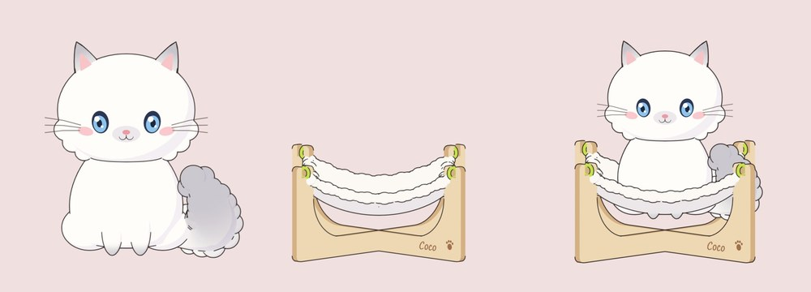

# Coco 🐾

Coco is a little white Persian kitten that lives on my Windows desktop. She sleeps in a fur hammock in the corner of the screen, walks along the taskbar, hops onto the top of whatever window I have open (and falls off when I drag it away), and purrs if I rub the cursor over her. If I pick her up and throw her she bounces off the screen edges and lands on her feet. When a game or a video goes fullscreen she gets out of the way.

You can also just click her and ask things. The answers come from a local model running in Ollama, so nothing leaves the PC. Or say "Hey Coco" and talk to her, in English or Hinglish. She talks back in her own voice.

Over time she picked up a lot of small jobs too: screenshots, explaining an error on screen, opening apps, notes, reminders, timers, music, focus sessions. There's also a small dashboard I can open on my phone to see what she's up to and chat with her when I'm away from the laptop.



## Installing it

1. Install [Ollama](https://ollama.com/download). Her brain runs inside it.
2. Grab `Coco-Setup-<version>.exe` from the [Releases](../../releases) page and run it. It installs just for your user, no admin needed, into `%LOCALAPPDATA%\Programs\Coco`.
3. The first time she starts she'll ask (one thing at a time, Yes or Not now) to download what she's missing: the chat model `qwen3.5:9b` (about 6 GB), a small memory model (about 640 MB) and her voice (about 350 MB). The speech recognition model downloads itself the first time she listens.

You'll want Windows 10 or 11 (64-bit) and 16 GB of RAM. An NVIDIA card with 8 GB or more makes a big difference. I use an RTX 5070 laptop. Without a GPU she still works, but she thinks slowly and hears with a smaller English-only model.

The installer isn't code-signed (certificates cost money every year), so SmartScreen will say "Windows protected your PC". Click More info, then Run anyway. If Smart App Control is turned on there's no Run anyway button at all. Either turn it off in Windows Security > App & browser control, or run Coco from source with a Start Menu shortcut (see below). That second option is what I do.

Everything she keeps lives in `%LOCALAPPDATA%\Coco`: settings, chats, memories, models and her `config.yaml`. Screenshots go to `Pictures\Coco`. Installing a newer version keeps all of that. The uninstaller asks if you want it deleted too, and the default answer is no.

Two things aren't in the download. One is the "Hey Coco" wake word model, because it's trained on your own voice (more on that below). Until you train one, hold Ctrl+Alt+V to talk. The other is the Hinglish speech model.

## Running from source

You need Python 3.12 (`py -0` lists what you have).

```powershell
cd coco-desktop-pet
py -3.12 -m venv .venv
.venv\Scripts\python -m pip install -r requirements-dev.txt
.venv\Scripts\python -m coco
```

Some notes:

- `--debug` logs every state change.
- `run_coco.pyw` starts her without a console window (open it with `.venv\Scripts\pythonw.exe` if Windows asks what to use).
- `.venv\Scripts\python tools_dev\make_shortcuts.py` puts a Coco shortcut in the Start Menu and on the desktop. It points at the venv's `pythonw.exe`, which is signed, so Smart App Control is happy with it. `--no-desktop` skips the desktop one and `--remove` takes them away again.
- The log is `%LOCALAPPDATA%\Coco\logs\coco.log`. The tray menu has an "Open log folder" item.
- Tray choices (size, paused or not) are saved in `settings.json`, and her mood in `mood.json`, both in that same folder.

## Building Coco.exe

```powershell
.venv\Scripts\python tools_dev\build_exe.py              # dist\Coco\Coco.exe, then a selftest
.venv\Scripts\python tools_dev\build_exe.py --installer  # also dist\Coco-Setup-<version>.exe
```

It's a one-folder PyInstaller build. `Coco.exe` is the cat, `Coco.exe --hub` is the dashboard and `Coco.exe --keep` is the keeper (see Troubleshooting). `Coco.exe --selftest --gpu` loads every part (Qt, her files, the tools, the dashboard, audio, voice, speech recognition on the GPU) and writes the result to `logs\selftest.txt`.

The NVIDIA libraries are the heavy part. Whisper turned out to only need cuBLAS, so that's all that gets bundled (771 MB instead of almost 1.9 GB). The list is `CUDA_KEEP` in `tools_dev\build_exe.py`, and `--measure-cuda` checks it again by taking the DLLs out one at a time. On a PC where Smart App Control blocks the fresh exe the selftest can't run, and `--untested` packages it anyway. The installer is made with [Inno Setup 6](https://jrsoftware.org/isinfo.php) from `packaging\coco.iss`.

## Chatting

If you're running from source you need the model once (about 6.6 GB):

```powershell
ollama pull qwen3.5:9b
```

`qwen3.5:4b` works too and is lighter. Set `brain.model` in `config.yaml` to switch.

Click her or press Ctrl+Alt+M, type, hit Enter. If Ollama isn't running she starts it in the background herself.

- The first answer after a break takes a few seconds. Ollama unloads the model after 5 idle minutes (`brain.keep_alive`) so it doesn't sit on the GPU while I'm gaming or in Blender. Opening the chat bubble already starts loading it, but only when the laptop is plugged in. Once it's warm the first words show up in about 0.4 s.
- She remembers the last few messages of a conversation and starts fresh after 30 quiet minutes. Things worth keeping long term go into her memory (below).
- Enter asks, Esc closes, Up brings back your last question. You can select and copy text from her answers, which is handy for code.
- Her face changes with the answer (happy, sad, playfully angry, surprised, curious, sleepy, love). Little bubbles above her head show 💗 when she's petted, zzz when she's asleep, ? while she thinks.
- Now and then she says something on her own, like teasing me for being up at 2 am. Those are pre-written lines from `cat.yaml`, no AI. `chat_ui.unprompted_lines: false` turns them off.
- No Ollama? `python -m coco --fake-brain` runs the chat with canned replies.
- `.venv\Scripts\python tools_dev\check_brain.py --samples` tells you if Ollama is up, whether the model is there, how fast it answers and whether the emotions come out right.

## Voice

Nothing you say leaves the PC, and nothing gets recorded to disk.

Her voice is Kokoro, running on the CPU. The two model files (`kokoro-v1.0.onnx` and `voices-v1.0.bin`) go in `%LOCALAPPDATA%\Coco\models\kokoro\`. The voice itself is set in `cats/coco/cat.yaml`: `voice_id` for English, `voice_hi` for Hinglish replies, and `pitch` 1.12, which makes her sound like a kitten. Tray > "Voice (she speaks)" mutes her.

Ways to talk to her:

- Hold Ctrl+Alt+V, speak, let go.
- Or say "Hey Coco" and then what you want, either in one go or after a short pause ("Hey Coco... go to sleep"). Tray > "Wake word" turns this off.
- A small ear shows above her head whenever she's actually recording.
- Short commands skip the AI and happen instantly: run, walk, sleep, get up, jump (onto your window), come here, stop, peek, play, stretch, groom, yawn, loaf. The Hinglish ones work too: so jao, bhaag, idhar aao, ruko, uth jao, chhup jao, mere saath khelo, khidki pe kood.
- Ask in Hinglish and she answers in Hinglish, written in English letters but spoken with a Hindi voice.

She hears with faster-whisper on the GPU, using about 2.2 GB of VRAM for two models. `large-v3-turbo` handles English. For Hinglish I use Oriserve's Whisper-Hindi2Hinglish-Apex, converted once into `%LOCALAPPDATA%\Coco\models\whisper\hinglish-apex\` (how is in [docs/ARCHITECTURE.md](docs/ARCHITECTURE.md#voice)). Every phrase goes through both and the better transcript wins. Without that folder she only understands English. Without an NVIDIA GPU she falls back to `small.en` on the CPU.

To see how well they do on your own voice:

```powershell
.venv\Scripts\python tools_dev\record_voice_test.py --set all
.venv\Scripts\python tools_dev\compare_ears.py
.venv\Scripts\python tools_dev\compare_hinglish.py
```

A note on the mic, since it matters. With "Microphone ready" on (tray), the mic stays open while she's visible so your first word doesn't get cut off. Only the last 1.5 seconds are kept, in memory, and Windows shows its mic icon the whole time. With the wake word on, that audio only goes through a tiny detector. When it fires, Whisper double-checks the last 2 seconds before she starts listening for real. Hiding her (Ctrl+Alt+C), a fullscreen app or quitting closes the mic completely.

Training your own "Hey Coco" takes about 10 minutes and works offline. You record yourself, then her own TTS makes thousands of extra "Hey Coco" clips in around 50 voices, plus words that sound close to it so she learns what not to wake up for:

```powershell
.venv\Scripts\python tools_dev\record_voice_test.py --set all
.venv\Scripts\python tools_dev\train_wake_word.py
```

It prints how many it missed and how often it woke up by mistake on clips it never trained on, then saves `models\wake\hey_coco.npz`.

## Things she can do on the PC

Type it, say it, English or Hinglish. Clear requests are handled straight away without the AI. Vaguer ones ("ugh, nudge me in an hour to drink water") go through the AI, and it can only pick from this list.

| Ask | What happens |
|---|---|
| "take a screenshot", "screenshot this window", "screenshot an area", or Ctrl+Alt+S | saved to `Pictures\Coco` and copied to the clipboard (she hides first) |
| "what's this error?", "explain my screen", "ye kya hai?" | she looks at the active window and explains it, takes 5 to 10 s |
| "open VS Code", "youtube kholo", "launch Blender" | apps, folders, websites, Start Menu shortcuts |
| "play Madira by Seedhe Maut on Spotify", "play lofi on YouTube" | plays it in the Spotify app, or opens the top YouTube video |
| "search YouTube for lofi", "google esp32 pinout" | opens the search page |
| "note down: buy an ESP32", "what's on my list?", "ESP32 wala ho gaya" | notes and to-dos, also kept in `Documents\Coco\notes.md` |
| "remind me at 6 to submit the assignment", "kal subah 9 baje yaad dilana" | she walks over at that time with Done and Snooze buttons |
| "set a timer for 5 minutes", "what reminders do I have?", "cancel the timer" | timers |
| "start focus", "focus for 50 minutes", "stop focus" | Pomodoro, 25/5 by default. She guards the taskbar and naps on breaks |
| "how's my battery?", "how hot is my GPU?" | she checks. She also gets sleepy when the battery is low |
| "pause the music", "next song", "volume 40", "gaana band karo" | media keys and volume |
| "do it for me: in Notepad, type my address" | see below |

"Do it for me" is for things none of the tools above cover. She reads the buttons and fields of the app through Windows accessibility and works through it one step at a time. A red chip says she's driving, and Esc stops her instantly. She never types into password fields or terminals, asks Yes or No before anything like send, delete, buy or install, and stays out of apps you list on the dashboard. It works well in Notepad, Calculator, Explorer, Chrome and the Settings app. Some apps draw their own UI and don't expose it, and there she just tells you she can't see inside.

The safety stuff is in the code, not just her prompt. She can only use tools that are registered, listed under `allowed_tools` in `cats/coco/cat.yaml` and switched on in tray > Tools. "Open X" never runs a command you typed; unknown names become a web search. Deleting notes or cancelling all reminders asks first, and closing the bubble counts as no. Asking about something ("how do reminders work?") doesn't start anything.

One OneDrive gotcha: if Windows syncs your Pictures and Documents, she saves to the plain local `C:\Users\<you>\Pictures\Coco` and `Documents\Coco` instead, so screenshots and notes don't get uploaded anywhere.

Your own shortcut names go in `config.yaml` under `open:`. Notes, reminders and chats are in `%LOCALAPPDATA%\Coco\coco.db`.

## Memory

She remembers lasting things about you. If I tell her my exam is on Friday, she notes it down as one short fact and a little note icon pops up. "remember that..." saves something on purpose, "what do you remember about me?" lists everything, and "forget that..." gives you buttons to choose what goes. "yaad rakhna" and "bhool jao" work too.

Before every answer she looks up the few memories closest in meaning, using the `qwen3-embedding:0.6b` model in Ollama on the CPU. So "when is my exam?" finds it, and "exam moved to Monday" updates the old fact instead of adding a second one. If you don't have that model (`ollama pull qwen3-embedding:0.6b`, about 640 MB) she falls back to matching words.

All of it stays in `coco.db`. The dashboard's Memories page shows everything, lets you add or delete, and has a Forget everything button. You can also switch memory off entirely.

## Screen time and breaks

She knows which app is in front (VS Code, a browser, a game, a call) and roughly how long I've been at the screen, so "what am I doing?" or "should I take a break?" actually make sense to her. Only the app's name is kept, never what's in the window.

After an hour without a proper break (5 minutes or more away) she suggests one, with three buttons: Taking a break, In 15 min, Not today. She won't interrupt focus mode, a chat with her, a game, a video or a call, and waits until you're out of it. The interval (30 minutes to 2 hours, or off) is on the dashboard. Today's screen time shows on the dashboard's home page and survives restarts.

## Clipboard and power

"what does this copied error mean?", "translate my clipboard to Hindi" or "copied text samjhao" make her read the clipboard. She only does that when asked, only text, up to 4000 characters, and anything that looks like a password, key or OTP is never read out. "copy your answer" puts her last reply on the clipboard without the *purrs*.

"lock my laptop" and "turn off the screen" happen right away. Sleep, restart and shut down always ask first, and restart and shut down wait 60 seconds so "cancel the shutdown" can still stop them.

## Web lookups

Off by default. Turn it on in the dashboard under Settings > Web lookups and she can look things up and answer in her own words, saying where it came from: "look up the Chandrayaan-3 mission", "tell me about ESP32 from wikipedia", "wikipedia pe ESP32 ke baare mein batao".

Wikipedia needs no key. Brave Search is optional and better for news; paste a free key from brave.com/search/api into the same settings section. With lookups off, nothing you ask leaves the laptop and "look up X" just opens your browser. With them on, only the question gets sent, never your name, memories or chats.

## More than one screen

Dashboard > Settings > Coco > Which screen. She stays on the main screen by default, or one you pick. "Follow me" moves her to whichever screen you've been working on for a few seconds; she wakes up in her bed over there. A quick glance doesn't count, and she waits 15 seconds before moving again. If her screen gets unplugged she moves to one that's still there, and goes back home when it's plugged in again.

## The dashboard

A small web app that runs next to her. It can turn her on and off (even when she's fully closed) and shows what she's doing with her real sprite, live. It also has your chats (typed, spoken or sent from the dashboard), notes, reminders, screenshots, what she did on the PC, what she remembers and her settings. Coco starts it herself when she starts.

1. On the laptop, open http://127.0.0.1:8765 and pick a PIN (4 to 12 digits). The first PIN can only be set from the laptop itself.
2. For phone access, install Tailscale on the laptop (tailscale.com/download, needs admin once) and on your phone, signed in to the same account. Then on the laptop:

   ```powershell
   tailscale serve --bg 8765
   ```

   Open the `https://<laptop>.<tailnet>.ts.net` address it prints on your phone and add it to your home screen.

How it's locked down: the hub only listens on 127.0.0.1, so nothing on your Wi-Fi or the internet can reach it, and Tailscale only lets your own signed-in devices through. Every page needs the PIN, which is stored as a salted scrypt hash. Five wrong tries lock it for 5 minutes, doubling each time. A sign-in lasts 30 days, and Change PIN or Sign out everywhere kicks every device out. Coco and the hub talk over a localhost-only link with a new secret token every time she starts. Chats stay in `coco.db` on the laptop. You can pause the history or wipe it from Settings, or have old messages deleted after a week, a month and so on. Answers to things you send from your phone stay silent on the laptop unless you turn on "Speak replies to this page".

## Playing with her

| Do this | She does this |
|---|---|
| Drag her | dangles by her scruff |
| Drag and let go mid-swing | flies off at your mouse speed, bounces off the edges, lands on her feet |
| Rub the cursor slowly back and forth over her | purrs |
| Click her | opens the chat bubble (and wakes her up if she's asleep) |
| Move or minimise the window she's standing on | she falls |
| Make a game, video or slideshow fullscreen | she hides, and comes back 2 s after it ends |

Hotkeys (change them in `config.yaml` under `ui.hotkeys`):

- Ctrl+Alt+C is the kill switch. It hides her instantly and stops whatever she's saying. Press it again to bring her back.
- Ctrl+Alt+M opens the chat without clicking her.
- Ctrl+Alt+D is the debug overlay: her state, position, speed, fps, and the surfaces she can stand on (green is the ground, blue are window tops, yellow is the active window, orange is her bed, pink is her body box).

The tray menu has Show/Hide, Size, Pause wandering, Start with Windows, the debug overlay, "Make Coco..." (trigger any behaviour on demand, useful for testing), Reload config + art, Open log folder and Quit.

## Tuning

Anything that feels like a number is in [`config.yaml`](config.yaml): speeds, gravity, bounciness, how often she does each thing (`behaviour.weights`), cooldowns, nap length, night hours, petting sensitivity, sizes, hotkeys, the AI settings (`brain`), the chat bubble (`chat_ui`) and how her mood drifts (`mood`). Edit it, then tray > Reload config + art. If you typo a key name it shows up in the log.

Her personality is in [`cats/coco/cat.yaml`](cats/coco/cat.yaml): which corner is home, her body box, behaviour overrides, the AI personality prompt, which animation goes with each emotion, her canned lines, her voice and the tools she's allowed to use.

## Sprites

`cats/coco/sprites/` has the final art, all 29 animations rendered in Blender. The old generated placeholders are in `cats/coco/sprites_placeholder/` (`tools_dev/make_placeholder_sprites.py` only ever writes there).

To add or replace an animation, render it as PNG frames (side view, facing left, transparent background, paws in the same spot every frame), then pack and check it:

```powershell
.venv\Scripts\python tools_dev\pack_frames.py renders\walk cats\coco\sprites\walk.png
.venv\Scripts\python -m pytest tests\test_manifest.py
```

Frame size, the anchor point, manifest keys and what every animation should show are all in [docs/SPRITES.md](docs/SPRITES.md).

## Development

```powershell
.venv\Scripts\python -m pytest              # about 630 tests, no window needed
.venv\Scripts\python -m ruff check .
.venv\Scripts\python -m ruff format .
.venv\Scripts\python tools_dev\demo_tour.py --target-window   # watch her go through every behaviour
```

The behaviour engine doesn't import Qt or anything Win32, so the tests drive her with a fake desktop (`Sim` in `tests/conftest.py`). Every Win32 call lives in `coco/desktop/windows.py`.

```
coco/
  app.py          wires everything together, runs the frame timer
  core/           config, events, cat definition, sprite manifest, paths, startup helpers
  behaviour/      state machine, physics, surfaces, petting, mood, canned lines
  desktop/        the Win32 layer, a fake desktop for tests, sensors
  ui/             cat window, bed, tray, speech bubble, debug overlay
  brain/          Ollama backend, streaming reply parser, prompt
  voice/          speech recognition, Kokoro voice, wake word, song-name fixing
  tools/          screenshots, apps, notes, reminders, Spotify, YouTube, lookups and the rest
  agent/          "do it for me"
  memory.py, screen_time.py, keeper.py, first_run.py, hub_link.py
coco_hub/         the dashboard (NiceGUI)
cats/coco/        cat.yaml and sprites
assets/           the hammock bed, mood bubbles, icons
packaging/        PyInstaller spec, Coco.exe entry point, Inno Setup script
tools_dev/        build script, sprite tools, voice tests, wake word training
tests/            pytest
docs/             architecture notes, sprite spec, the original spec PDF, photos
```

## Troubleshooting

She or the dashboard disappeared after the laptop woke up. That's what the Coco keeper is for. It's a Task Scheduler task Coco creates for herself, and it runs when you sign in, when you unlock, when the laptop wakes up and every 5 minutes. It brings back whatever is missing out of Coco, the dashboard, Ollama and Tailscale's tray app. I needed it because a shutdown that doesn't finish closes every app but leaves you signed in, so "Start with Windows" never fires again. If you quit her yourself she stays off. What it did is in `logs\keeper.log`, and if she ever freezes, `logs\hang.txt` shows where. You can turn the keeper off on the dashboard (Settings > Keep Coco and her dashboard running).

If you start her from a terminal that lives inside a packaged desktop app, Windows can hand her a private copy of AppData, which means a different PIN, different chats and missing models. She notices, asks the keeper to start her properly and quits.

She's gone. Press Ctrl+Alt+C or use tray > Show. If something is fullscreen she's hiding on purpose (the debug overlay says `fullscreen=True`).

"Hotkey ... is already used by another program" in the log means another app took that combination. Pick a different one in `config.yaml`.

She never jumps onto my window. A maximised window has no room above it, so make it a bit smaller.

"My brain is asleep" in the bubble means Ollama isn't reachable and she couldn't start it. Check that it's installed (`ollama --version`) and run `tools_dev\check_brain.py` for details.

"I don't have my thinking model yet" means the model isn't downloaded. Run `ollama pull qwen3.5:9b`, or point `brain.model` at something you already have (`ollama list`).

Answers take tens of seconds. Make sure `brain.think` is `false`. With thinking on, the model writes thousands of hidden words before it answers.

To reset everything, quit her and delete `%LOCALAPPDATA%\Coco\settings.json`. Delete `mood.json` as well if you want her mood and your bond to start over.

## License

MIT. See [LICENSE](LICENSE).
