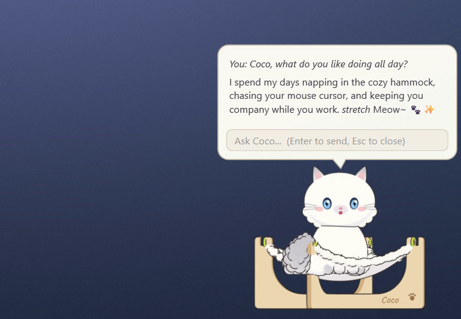

# Coco 🐾

A little white Persian kitten that lives on my Windows desktop.

She naps in a hammock in the corner, walks along the taskbar and climbs onto whatever window I have open. Drag her around and throw her and she lands on her feet (mostly). Rub the cursor over her and she purrs.

You can also talk to her. Click her and type, or say "Hey Coco", in English or Hinglish, and she answers out loud. Everything runs locally through Ollama, so nothing leaves the PC.



## What she can do

- Chat, with a face that matches what she's saying
- Simple commands like "Coco, run" or "so jao"
- Screenshots, and "what's this error?" for whatever is on screen
- Open apps and sites, play songs on Spotify or YouTube
- Notes, reminders, timers and a focus timer
- Remember things you tell her
- Nudge you to take a break when you've been sitting too long
- Do small things inside other apps for you (she asks before anything risky)

There's also a small dashboard I use from my phone (over Tailscale, behind a PIN) to check on her and chat with her when I'm not at my desk.

## Installing

1. Install [Ollama](https://ollama.com/download)
2. Download the installer from [Releases](../../releases) and run it
3. On first start she'll offer to download her model (~6 GB), her memory model and her voice

You'll want Windows 10/11 and ideally an NVIDIA GPU. It works without one, just slower.

The exe isn't signed, so SmartScreen will complain (More info > Run anyway). If you have Smart App Control on, Windows won't run it at all. In that case run it from source.

## Running from source

Needs Python 3.12.

```powershell
py -3.12 -m venv .venv
.venv\Scripts\python -m pip install -r requirements-dev.txt
ollama pull qwen3.5:9b
.venv\Scripts\python -m coco
```

The voice files can be fetched with `tools_dev\get_voice.py`. The speech model downloads itself the first time she listens. `tools_dev\make_shortcuts.py` adds a Start Menu shortcut.

For the dashboard, run `run_hub.pyw` (Coco also starts it on her own) and open http://127.0.0.1:8765. For phone access I use `tailscale serve --bg 8765`.

The "Hey Coco" wake word is trained on your own voice:

```powershell
.venv\Scripts\python tools_dev\record_voice_test.py --set all
.venv\Scripts\python tools_dev\train_wake_word.py
```

Until then, hold Ctrl+Alt+V to talk.

## A few hotkeys

- Ctrl+Alt+M: chat with her
- Ctrl+Alt+V: hold to talk
- Ctrl+Alt+S: screenshot
- Ctrl+Alt+C: hide her / bring her back
- Ctrl+Alt+D: debug overlay

Most other things (speeds, sizes, hotkeys, which model) are in `config.yaml`. Her personality and voice are in `cats/coco/cat.yaml`.

## Notes

- Built with Python, PySide6, Ollama, faster-whisper and Kokoro. The dashboard is NiceGUI.
- `python -m pytest` runs the tests.
- `tools_dev\build_exe.py --installer` builds the exe and installer.
- How it all fits together is in [docs/ARCHITECTURE.md](docs/ARCHITECTURE.md).

MIT licensed.
